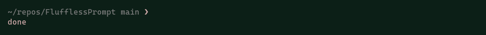

# Fluffless Prompt

**A quiet Oh My Zsh theme — directory, Git state, failure/status and a small clock. No boxes, no glyphs, no retro phosphor cosplay.**

Warm neutrals. Dense and calm. Made for people who like their terminal readable, not theatrical.

<p align="center"></p>



## What it shows

Left side: current directory, Git branch, optional dirty marker and the prompt marker.

Right side: a small clock. Failed commands show their exit code instead of the arrow.

```text
~/code/fluffless-prompt main• ❯
```

```text
~/code/fluffless-prompt main• 2 ❯
```

## Install

```bash
cp fluffless.zsh-theme ~/.oh-my-zsh/custom/themes/
```

Set it in `~/.zshrc`:

```zsh
ZSH_THEME="fluffless"
```

Reload:

```zsh
source ~/.zshrc
```

No plugins required. The theme caches Git state per directory for five seconds to avoid forking on every prompt.

## Customize

All colors are 256-color indexes. Override before Oh My Zsh loads, or in the file:

```zsh
FLUFFLESS_FG=252
FLUFFLESS_DIM=244
FLUFFLESS_MUTED=238
FLUFFLESS_ACCENT=180
FLUFFLESS_ERROR=203
FLUFFLESS_GIT_CACHE_TTL=10
FLUFFLESS_SHOW_GIT=0
FLUFFLESS_SHOW_CLOCK=0
```

Set `FLUFFLESS_SHOW_GIT=0` to drop the branch/dirty segment, or `FLUFFLESS_SHOW_CLOCK=0` for a left-only prompt.

## Design

- warm near-black and off-white, never phosphor green
- no borders, boxes, pictograms or alphabet soup
- no glyph-only setup that breaks on stock fonts
- one color for the prompt, one for Git state, one for failure
- subdued clock in the far right corner

## Related Mark44928 projects

- [Greenit](https://github.com/Mark44928/Greenit) · [Bluney](https://github.com/Mark44928/Bluney) · [Yellen](https://github.com/Mark44928/Yellen) — full theme families
- [Weatui](https://github.com/Mark44928/Weatui) — friendly terminal weather TUI
- [SnakTUI](https://github.com/Mark44928/SnakTUI) — neon terminal Snake
- [TuxMorph](https://github.com/Mark44928/TuxMorph) — living ASCII Tux
- Full hub: [Mark44928](https://mark44928.github.io/Mark44928/)

## Test

```bash
make check
```

## License

MIT.

---

<div align="center">

</div>
