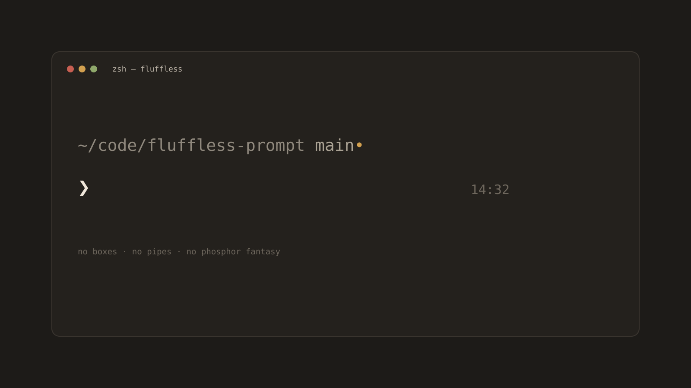

# Fluffless Prompt

<p align="center"></p>

A minimal Oh My Zsh theme for people who like their terminal dense, calm and readable — not repackaged 1983. It keeps the useful signal, drops the theater, and uses warm neutrals instead of neon green, ASCII pipes or fake CRT nostalgia.



## What it shows

Left side: current directory, Git branch, optional dirty marker and the prompt marker.

Right side: a small clock. Failed commands show their exit code instead of the arrow.

```text
~/code/fluffless-prompt main• ❯
```

```text
~/code/fluffless-prompt main• 2 ❯
```

## Install

```bash
cp fluffless.zsh-theme ~/.oh-my-zsh/custom/themes/
```

Set it in `~/.zshrc`:

```zsh
ZSH_THEME="fluffless"
```

Reload:

```zsh
source ~/.zshrc
```

No plugins required. The theme caches Git state per directory for five seconds to avoid forking on every prompt.

## Customize

All colors are 256-color indexes. Override before Oh My Zsh loads, or in the file:

```zsh
FLUFFLESS_FG=252
FLUFFLESS_DIM=244
FLUFFLESS_MUTED=238
FLUFFLESS_ACCENT=180
FLUFFLESS_ERROR=203
FLUFFLESS_GIT_CACHE_TTL=10
```

## Design

- warm near-black and off-white, never phosphor green
- no borders, boxes, pictograms or alphabet soup
- no glyph-only setup that breaks on stock fonts
- one color for the prompt, one for Git state, one for failure
- subdued clock in the far right corner where it will not fight your command line

## Test

```bash
make check
```

This runs Zsh syntax checks and verifies the theme renders a Git branch in a temporary repository.

MIT.
